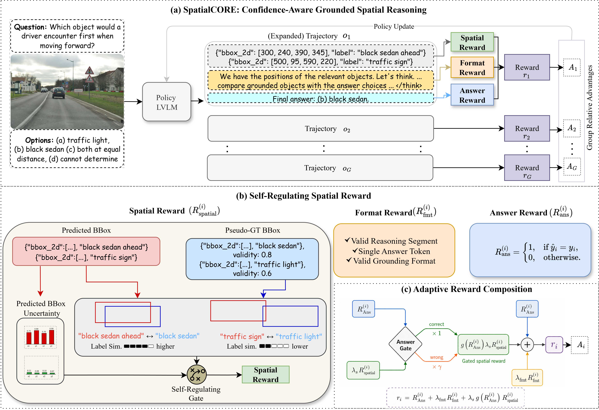

# SpatialCORE
SpatialCORE (Spatially COnfident REasoning), a post-training framework that uses the confidence of the generated grounding as a learning signal for spatial reasoning.

## Abstract

Large Vision-Language Models (LVLMs) have made remarkable progress across visual perception tasks, yet spatial reasoning remains a persistent weakness, especially for questions that require reasoning over visual space. Recent spatial-reasoning methods incorporate generated grounding, where models predict bounding boxes, masks, or other localization outputs for task-relevant objects as part of their reasoning trace. However, these approaches typically optimize for the final answer correctness alone, without checking whether the generated grounding confidently localizes the task-relevant objects. We present SpatialCORE (Spatially COnfident REasoning), a post-training framework that uses the confidence of the generated grounding, i.e., predicted bounding boxes, as a learning signal for spatial reasoning. SpatialCORE introduces a self-regulating spatial reward that modulates each bounding box's reward contribution to the reasoning by its coordinate uncertainty, upweighting confident predictions and downweighting uncertain ones. An answer gate further couples grounding and answer rewards, ensuring spatial optimization is grounded in final-answer correctness. SpatialCORE achieves state-of-the-art results among open-source and specialized spatial reasoning models across diverse benchmarks, and transfers effectively in zero-shot settings to unseen data distributions.

## Architecture



## Results

Source code will be released upon acceptance.

## Citation

If you find this work useful, please cite:

```bibtex
@article{sultan2026spatialcore,
  title={SpatialCORE: Confidence-Aware Grounded Spatial Reasoning in Large Vision--Language Models},
  author={Sultan, Rafi Ibn and Zhou, Xiangyu and Chowdhury, Md. Sajid Alam and Li, Chengyin and Khanduri, Prashant and Brocanelli, Marco and Zhu, Dongxiao},
  journal={arXiv preprint},
  year={2026}
}
```